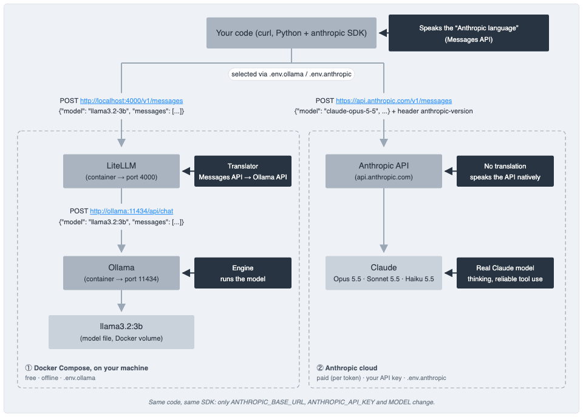

# claude-architect-foundations-prep

Step-by-step Python kata to learn the Claude Messages API (Claude Architect Foundations prep).
The same code runs against the real Anthropic API or a free local model (Ollama behind a LiteLLM proxy).



## Backends

| | Anthropic (default) | Ollama via LiteLLM |
|---|---|---|
| Env file | `.env.anthropic` | `.env.ollama` |
| `ANTHROPIC_BASE_URL` | `https://api.anthropic.com` | `http://localhost:4000` |
| `ANTHROPIC_API_KEY` | your `sk-ant-...` key | `sk-local-dummy` (LiteLLM `master_key`) |
| `MODEL` | `claude-opus-5-5` | `llama3.2-3b` (LiteLLM alias) |
| Cost | per token (see `usage`) | free, offline |
| `anthropic-version` header | required (SDK sends it; curl: `2026-10-21`) | optional |
| `temperature` / `top_p` / `top_k` | rejected (400) | accepted |
| Thinking | always on (Opus 5.5) | none |
| Prefill | rejected (400) | accepted |
| Structured outputs / tool use | reliable | weak or ignored |

The SDK reads `ANTHROPIC_BASE_URL` and `ANTHROPIC_API_KEY` itself, so `anthropic.Anthropic()` needs no arguments.
`src/backend.py` picks the env file from `BACKEND`:

```bash
python3 src/step1_hello.py                  # Anthropic
BACKEND=ollama python3 src/step1_hello.py   # Ollama
```

**Why LiteLLM?** Ollama speaks its own API (`/api/chat`). LiteLLM exposes an Anthropic-compatible
`/v1/messages` endpoint and translates both ways, so you use the real SDK and only switch 3 env vars.
The alias `llama3.2-3b` → `ollama_chat/llama3.2:3b` lives in `litellm-config.yaml`.

Claude models (input / output per MTok): Opus 5.5 $4 / $20 · Sonnet 5.5 $2 / $10 · Haiku 5.5 $0.10 / $0.50.

## Setup

```bash
# Secrets (gitignored; never commit or paste your key)
cp .env.anthropic.example .env.anthropic   # then add your key
cp .env.ollama.example .env.ollama

# Local model
docker compose up -d
docker compose exec ollama ollama pull llama3.2:3b #for downloading the ollama model

# Python venv, next to the repo
python3 -m venv ../env && source ../env/bin/activate
pip install -r requirements.txt
```

Run scripts from the repo root with `python3` (a `python` shell alias can bypass the venv).

| Docker command | Effect |
|---|---|
| `docker compose ps` | service status |
| `docker compose logs -f litellm` | proxy logs (first place to look on errors) |
| `docker compose restart litellm` | reload `litellm-config.yaml` |
| `docker compose down` | stop (model volume kept) |

## Steps

| # | File | Concept |
|---|---|---|
| 1 | `step1_hello.py` | single `messages.create()` call, raw JSON response |
| 2 | `step2_multiturn.py` | stateless API: client keeps and resends the history |
| 3 | `step3_streaming.py` | `messages.stream()`, `text_stream`, `get_final_message()` |
| 4 | `step4_structured.py` | structured outputs with `output_config` JSON schema |
| 4b | `step4b_stop_sequences.py` | legacy: XML tags + `stop_sequences` (no guarantee) |
| 4c | `step4c_pydantic.py` | `messages.parse()` + Pydantic → `parsed_output` |

## Evals

`evals/contact_extraction/` measures `extract_contact()` (step 4) against hand-labeled cases.

| File | Role |
|---|---|
| `cases.json` | input emails + `expected` output |
| `LABELING.md` | rules used to write `expected` |
| `run_eval.py` | runs each case and grades the output twice: by code and by a judge model |

```bash
python3 evals/contact_extraction/run_eval.py                   # test Claude
BACKEND=ollama python3 evals/contact_extraction/run_eval.py    # test llama (the judge stays Claude Haiku)
```

For each case: expected vs output, then the verdict of both graders (disagreements are flagged), then both scores.
The judge is never the tested model, and always runs on the Anthropic API.

## References

- [Messages API](https://docs.claude.com/en/api/messages) · [Tool use](https://docs.claude.com/en/docs/agents-and-tools/tool-use/overview)
- [LiteLLM proxy config](https://docs.litellm.ai/docs/proxy/configs) · [LiteLLM `/v1/messages`](https://docs.litellm.ai/docs/anthropic_unified) · [LiteLLM Ollama](https://docs.litellm.ai/docs/providers/ollama)
- [Ollama API](https://github.com/ollama/ollama/blob/main/docs/api.md) · [Compose services](https://docs.docker.com/reference/compose-file/services/)
